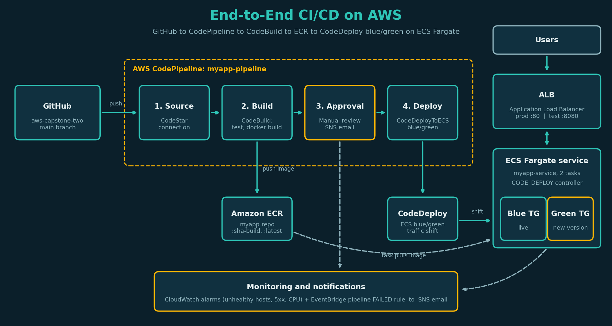
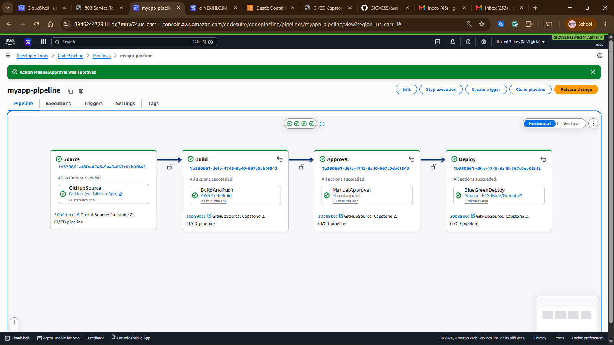
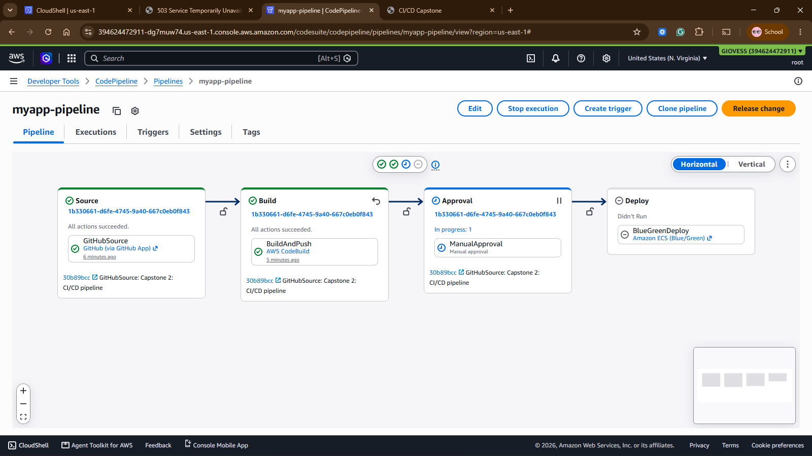
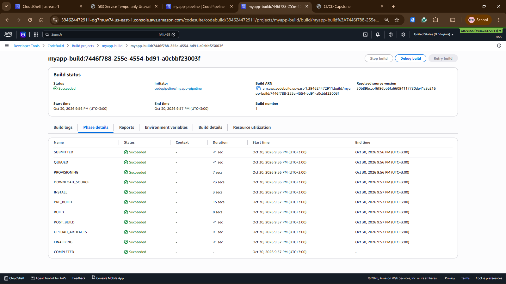
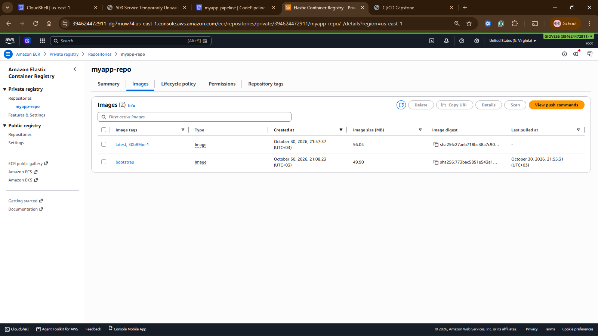
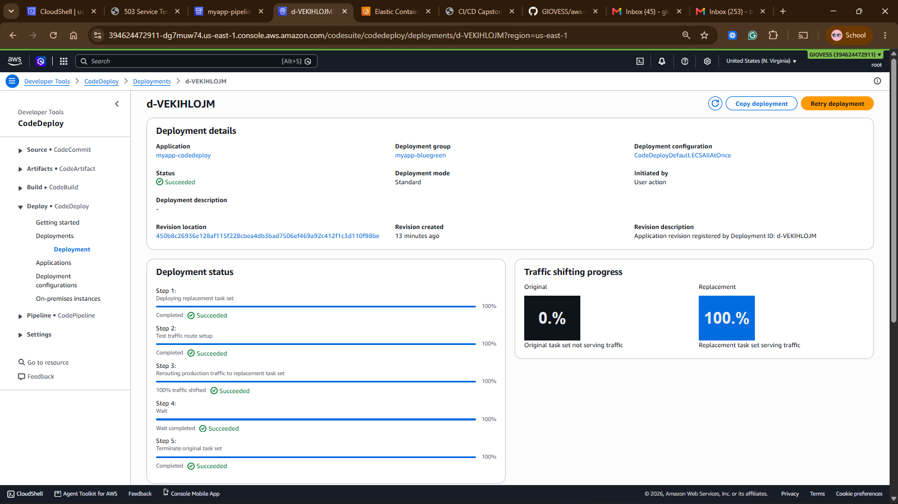
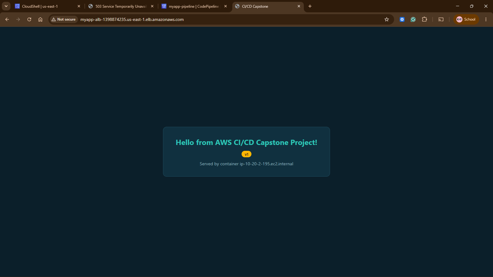
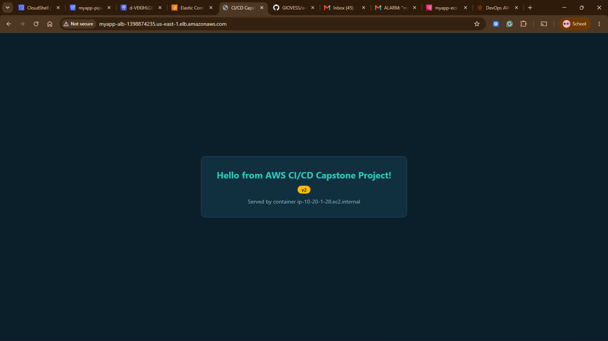
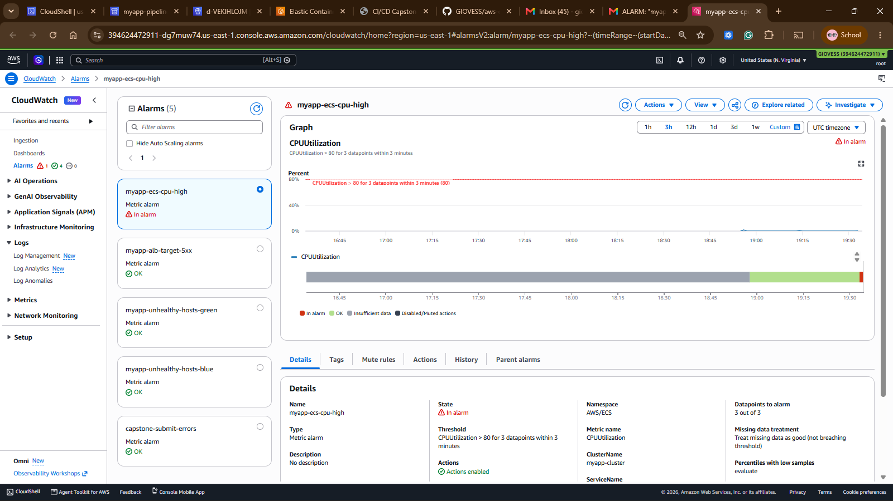
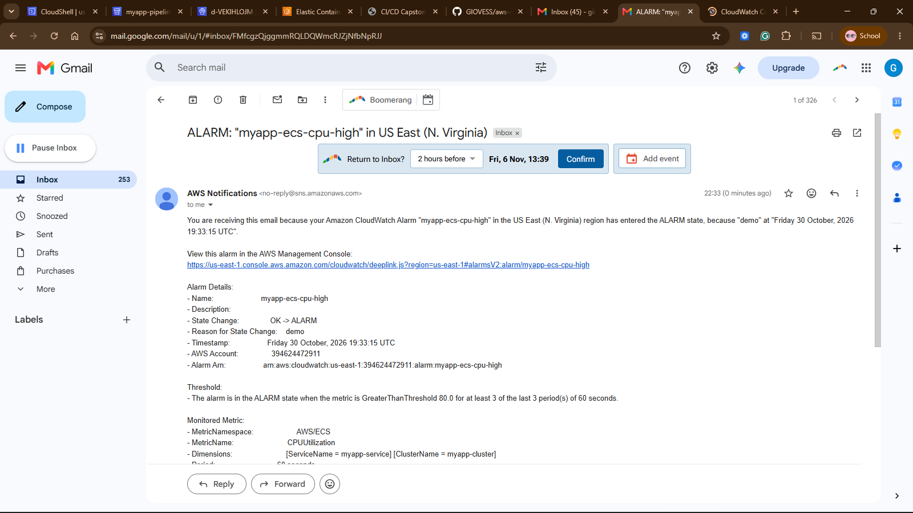

# Capstone 2: End-to-End CI/CD on AWS

Every push to `main` flows through CodePipeline: GitHub, CodeBuild (tests, Docker build, push to ECR), a manual approval, then a CodeDeploy blue/green deployment to ECS Fargate behind an Application Load Balancer. CloudWatch alarms and SNS email cover failures.



## Repository layout

```
src/app.js, src/package.json, src/package-lock.json   Express app
tests/app.test.js                                      Jest + supertest unit tests
Dockerfile                                             node:20-alpine, non-root
buildspec.yml                                          install, test, build, push, write artifacts
appspec.yml                                            CodeDeploy ECS blue/green spec
taskdef.json                                           ECS task definition template
infrastructure.yml                                     CloudFormation for all AWS resources
pipeline-diagram.png                                   Final pipeline flow
docs/screenshots/                                      Evidence
```

## How it works

| Stage | What happens |
|---|---|
| Source | GitHub via CodeStar connection, triggered on push to `main` |
| Build | CodeBuild runs `npm ci` and Jest, builds the image, pushes `:<sha>-<build>` and `:latest` to `myapp-repo`, emits `imageDetail.json`, `appspec.yml`, `taskdef.json` |
| Approval | Manual approval, SNS email notification |
| Deploy | CodeDeployToECS registers a new task definition (image injected into `<IMAGE1_NAME>`), starts a green task set, shifts prod traffic from the blue target group, terminates blue after 5 minutes. Automatic rollback on failure |

Prod traffic is on port 80, the replacement (green) task set is reachable for testing on port 8080 during a deployment.

## Monitoring

| Signal | Mechanism |
|---|---|
| Unhealthy targets (blue and green) | CloudWatch alarms to SNS |
| ALB target 5xx | CloudWatch alarm to SNS |
| ECS CPU over 80% | CloudWatch alarm to SNS |
| Pipeline execution FAILED | EventBridge rule to SNS |
| Approval requested | Pipeline approval action to SNS |

## Deploy from scratch

```bash
export AWS_REGION=us-east-1
export ACCOUNT_ID=$(aws sts get-caller-identity --query Account --output text)
export ECR=$ACCOUNT_ID.dkr.ecr.$AWS_REGION.amazonaws.com

# 1. ECR repo and bootstrap image (the ECS service needs an image to start)
aws ecr create-repository --repository-name myapp-repo --region $AWS_REGION
aws ecr get-login-password --region $AWS_REGION | docker login --username AWS --password-stdin $ECR
docker build --platform linux/amd64 -t myapp-repo .
docker tag myapp-repo:latest $ECR/myapp-repo:bootstrap
docker push $ECR/myapp-repo:bootstrap

# 2. Create a GitHub connection in the console (Developer Tools > Settings > Connections), authorize it, copy the ARN

# 3. Deploy
aws cloudformation deploy --template-file infrastructure.yml --stack-name myapp-cicd \
  --capabilities CAPABILITY_NAMED_IAM --region $AWS_REGION \
  --parameter-overrides \
    BootstrapImageUri=$ECR/myapp-repo:bootstrap \
    GitHubConnectionArn=<connection-arn> \
    AlertEmail=<you@example.com>
```

Confirm the SNS subscription email, then approve the first pipeline run.

## Evidence

### Pipeline, all stages succeeded


### Manual approval stage


### CodeBuild run (tests, build, push)


### Image in ECR


### CodeDeploy blue/green deployment


### Live app behind the ALB (before and after a commit)



### CloudWatch alarms and SNS email



## Teardown

```bash
aws s3 rm s3://myapp-pipeline-artifacts-$ACCOUNT_ID-$AWS_REGION --recursive
aws cloudformation delete-stack --stack-name myapp-cicd
aws ecr delete-repository --repository-name myapp-repo --force
```

Do not edit the task definition resource in `infrastructure.yml` after the first CodeDeploy run. CodeDeploy owns the service task definition from then on.
